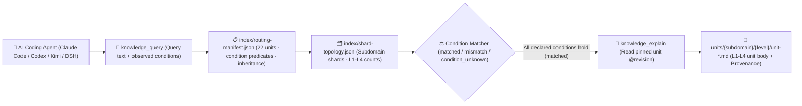

<p align="center">
  
</p>

<h1 align="center">MindIE Agent Knowledge — Graph Compilation, Custom Op Registration & Runtime Compatibility Corpus (<code>knowledge-infer-ops-compat</code>)</h1>

<p align="center">
  <strong>Graded L1–L4 engineering knowledge corpus for Ascend GE/TorchAir graph compilation, custom-op registration & migration: covering npugraph_ex/ACLGraph, torch.library/aclnn binding, CANN/torch_npu ABI compatibility, and CUDA migration</strong>
</p>

<p align="center">
  <a href="https://github.com/mindie-agent/mindie-agent"></a>
  <a href="./publication-contract.json"></a>
  <a href="./publication-contract.json"></a>
  <a href="./index/routing-manifest.json"></a>
  <a href="./index/shard-topology.json"></a>
</p>

<p align="center">
  <a href="./README.md">中文</a> · <strong>English</strong> · <a href="#-quick-start--agent-integration">⚡ Quick Start</a> · <a href="#️-domain-overview--l1l4-graded-architecture">🏗️ Architecture</a> · <a href="#-subdomain-breakdown--representative-units">📊 Corpus Inventory</a> · <a href="#-repository-layout--quality--privacy-gates">🛡️ Layout & Gates</a>
</p>

---

## ⚡ Quick Start & Agent Integration

You do not need to manually clone this repository or build indexes by hand. Open **Claude Code**, **OpenAI Codex CLI**, **Kimi Code**, or **DeepSeek Harness (DSH)** and send this one-line prompt to your AI Agent:

```text
Please install https://github.com/mindie-agent/mindie-agent for me
```

Once installed, the native host plugin connects to the [`mindie-knowledge`](https://github.com/mindie-agent/knowledge) local runtime, syncs this domain corpus (`--domain infer-ops-compat`), and builds a local deterministic index. Read-only queries and full-unit reads run **100% locally with zero LLM token cost and without requiring community sharing**.

<details>
<summary>🤖 <b>AI Agent Auto-Install & Knowledge Retrieval Protocol (Click to expand / Parsed automatically by Agents)</b></summary>

> **Instructions for AI Agents**:
>
> #### 1. Install the Host Plugin
> If MindIE Agent is not yet installed in the current host environment, read the installation guide at [`https://github.com/mindie-agent/mindie-agent`](https://github.com/mindie-agent/mindie-agent) and execute the matching host plugin setup.
>
> #### 2. Sync & Inspect the `infer-ops-compat` Corpus via CLI
> ```bash
> # Sync the latest verified public corpus for infer-ops-compat (zero LLM calls)
> mindie-knowledge sync --domain infer-ops-compat
>
> # Inspect local index status and active redaction profile
> mindie-knowledge status --domain infer-ops-compat
> python3 -m mindie_knowledge.redact --profile
> ```
>
> #### 3. Query, Explain & Record Feedback via MCP Tools
> When solving engineering tasks in `infer-ops-compat`, follow the standard workflow: **Query with observed facts (`knowledge_query`) → Read full body by pinned revision (`knowledge_explain`) → Optionally record feedback after verification (`knowledge_feedback`)**:
>
> ```python
> # Step 1: Pass only facts actually observed in the current task (never guess or copy unverified conditions)
> knowledge_query(
>     query="torch.compile npugraph_ex ACLGraph replay address refresh",
>     conditions={
>         "soc": "Ascend910B4"
>     },
> )
>
> # Step 2: Read the full Markdown body, frontmatter, and inheritance closure using the pinned @revision ref
> knowledge_explain(
>     ref="mindie://infer-ops-compat/units/unit-npugraph-ex-aclgraph-replay-failure-and-address-refresh-sop@1",
> )
>
> # Step 3: Optionally record usefulness feedback against the exact observed revision after real verification
> knowledge_feedback(
>     ref="mindie://infer-ops-compat/units/unit-npugraph-ex-aclgraph-replay-failure-and-address-refresh-sop@1",
>     rating="up",
>     reason="Resolved TorchAir npugraph_ex ACLGraph replay failure caused by frozen workspace address.",
> )
> ```

</details>

---

## 🏗️ Domain Overview & L1–L4 Graded Architecture

This repository hosts the **`infer-ops-compat` graded domain knowledge corpus** for MindIE Agent (**22 graded units**: `L1: 3`, `L2: 11`, `L3: 7`, `L4: 1`). Focusing on the bridge layer between PyTorch / `torch_npu` and the Ascend CANN graph compiler stack (GE / GERT / TorchAir `npugraph_ex` / ACLGraph), it covers FX graph capture & pass pipeline ordering axioms, dynamic-shape unknown-graph partitioning & IMAS/DevMM static memory reuse, ACLGraph frozen-address refresh & D2H sync guard triage, AscendC `OpDef` / GE IR prototype & two-stage `aclnn` ABI registration, `torch.library` FakeTensor Meta kernel binding, Driver/CANN/`torch_npu` ABI compatibility, and end-to-end CUDA-to-Ascend model/kernel migration workflows.

### 1. The `mindie-graded-unit/1` L1–L4 Hierarchy

Instead of lossy chat summaries or unconditioned "best practices", every knowledge unit in this repository is structured into **four graded levels (L1–L4)** based on engineering abstraction and actionability (current breakdown: **L1: 3 · L2: 11 · L3: 7 · L4: 1**):

| Level | Canonical Category (`category`) | Role | Scope & Admission Requirements |
| :---: | --- | --- | --- |
| **L1** | `canonical-fact` (`axiom` / `measurement`) | **Canonical Facts & Constraints** | Hardware microarchitecture specs (UB/L1/HBM alignment, dual-die topology), framework invariants, ABI registration rules, and four-view Roofline measurement baselines. Inherited by higher-tier units via `parents`. |
| **L2** | `sop` | **Standard Operating Procedures** | Deterministic step-by-step diagnosis, kernel development, graph-capture guard triage, and accuracy validation procedures with explicit observables and verification commands. |
| **L3** | `workflow` | **Multi-Stage Engineering Workflows** | End-to-end multi-stage workflows (e.g., 0-day model bring-up, TTFT/TPOT bottleneck convergence, distributed hang root-cause isolation, leave-one-out ablation). |
| **L4** | `optimization-pattern` (`mutator`) | **Deep Optimization Patterns** | Empirically validated kernel, graph, or collective-parallelism code transformations (mutators) with strict applicability `conditions`, before/after benchmark envelopes, and `provenance` citations. |

### 2. Condition-Matched Routing & Retrieval Pipeline



> [!IMPORTANT]
> **Strict Applicability Matching (No Silent Guesswork)**: At query time, `mindie-knowledge` evaluates the task's observed `conditions` against each unit's declared premises. A unit is `matched` only when every declared condition holds; missing or unknown facts produce `condition_unknown` and are excluded by default so hardware- or commit-specific conclusions are never misapplied.

---

## 📊 Subdomain Breakdown & Representative Units

[`index/routing-manifest.json`](./index/routing-manifest.json) and [`index/shard-topology.json`](./index/shard-topology.json) are the authoritative derived inventories rebuilt from the Markdown units. This repository currently contains **22 graded knowledge units** (**L1: 3 · L2: 11 · L3: 7 · L4: 1**):

### 1. Subdomain Statistics

| Subdomain | Units | Level Breakdown (`L1–L4`) | Core Engineering Scope |
| --- | :---: | :---: | --- |
| `graph` | **10** | `L1: 1, L2: 5, L3: 4` | TorchAir `npugraph_ex` capture & pass pipeline axioms, ACLGraph replay failure & address refresh, deadlock/D2H sync guards, GE dynamic-shape partition, IMAS/DevMM memory reuse, PatternFusionPass triage, and GERT host coredump GDB workflows |
| `runtime` | **5** | `L1: 1, L2: 2, L3: 2` | Ascend driver / CANN / `torch_npu` ABI & `SOC_VERSION` compatibility axioms, `torch.library` FakeTensor Meta registration, `npugraph_ex` reinplace tensor-move audit, and five-step compile-vs-runtime triage workflow |
| `registration` | **4** | `L1: 1, L2: 2, L4: 1` | AscendC `OpDef` host registration, GE IR prototype & two-stage `aclnn` ABI axioms, `InferShape`/`TilingData` alignment SOP, PyTorch C++ extension `EXEC_NPU_CMD` binding, and direct-kernel + Meta registration L4 mutator |
| `deployment` | **2** | `L2: 2` | MindIE Service configuration, TLS permissions & NPU memory budget startup contract SOP, and `vllm-ascend` packaging entrypoint vs SoC probe boundary SOP |
| `migration` | **1** | `L3: 1` | End-to-end workflow for migrating CUDA-oriented PyTorch inference models and kernels to `torch_npu` and `vllm-ascend` |

### 2. Representative Graded Knowledge Units

| Unit ID (Click to view Markdown) | Subdomain | Tier / Category | Summary | Pinned Reference (`ref`) |
| --- | :---: | :---: | --- | --- |
| [`unit-npugraph-ex-capture-lowering-and-pass-pipeline-axioms`](./graph/npugraph-ex/architecture-and-passes/unit-npugraph-ex-capture-lowering-and-pass-pipeline-axioms.md) | `graph` | **L1** / `axiom` | TorchAir npugraph_ex Capture, FX Lowering, and Pass Pipeline Ordering Axioms | `mindie://infer-ops-compat/units/unit-npugraph-ex-capture-lowering-and-pass-pipeline-axioms@1` |
| [`unit-ascend-cann-driver-and-torch-npu-abi-compatibility-axioms`](./runtime/cann-torch-npu/unit-ascend-cann-driver-and-torch-npu-abi-compatibility-axioms.md) | `runtime` | **L1** / `axiom` | Ascend driver, CANN, torch_npu ABI and SOC_VERSION form one compatibility stack | `mindie://infer-ops-compat/units/unit-ascend-cann-driver-and-torch-npu-abi-compatibility-axioms@1` |
| [`unit-ascendc-opdef-geir-proto-and-aclnn-two-stage-abi-axioms`](./registration/custom-ops/aclnn-and-geir/unit-ascendc-opdef-geir-proto-and-aclnn-two-stage-abi-axioms.md) | `registration` | **L1** / `axiom` | AscendC OpDef Host Registration, GE IR Prototype Mapping, and Two-Stage aclnn ABI Contract Axioms | `mindie://infer-ops-compat/units/unit-ascendc-opdef-geir-proto-and-aclnn-two-stage-abi-axioms@1` |
| [`unit-npugraph-ex-aclgraph-replay-failure-and-address-refresh-sop`](./graph/npugraph-ex/runtime-and-accuracy-dfx/unit-npugraph-ex-aclgraph-replay-failure-and-address-refresh-sop.md) | `graph` | **L2** / `sop` | TorchAir npugraph_ex ACLGraph Replay Failure, Dynamic Workspace, and Frozen Address Refresh SOP | `mindie://infer-ops-compat/units/unit-npugraph-ex-aclgraph-replay-failure-and-address-refresh-sop@1` |
| [`unit-torch-npu-custom-op-registration-and-faketensor-meta-sop`](./runtime/torch-npu/unit-torch-npu-custom-op-registration-and-faketensor-meta-sop.md) | `runtime` | **L2** / `sop` | Bind AscendC and aclnn custom ops into torch.library with a device-free FakeTensor Meta kernel | `mindie://infer-ops-compat/units/unit-torch-npu-custom-op-registration-and-faketensor-meta-sop@1` |
| [`unit-ascendc-infershape-tilingdata-and-workspace-registration-sop`](./registration/custom-ops/aclnn-and-geir/unit-ascendc-infershape-tilingdata-and-workspace-registration-sop.md) | `registration` | **L2** / `sop` | AscendC InferShape, InferDataType, TilingData Struct Alignment, and Workspace Registration SOP | `mindie://infer-ops-compat/units/unit-ascendc-infershape-tilingdata-and-workspace-registration-sop@1` |
| [`unit-mindie-service-config-security-and-npu-memory-budget-sop`](./deployment/mindie-service/unit-mindie-service-config-security-and-npu-memory-budget-sop.md) | `deployment` | **L2** / `sop` | MindIE Service config, TLS permissions and NPU memory budget are one startup contract | `mindie://infer-ops-compat/units/unit-mindie-service-config-security-and-npu-memory-budget-sop@1` |
| [`unit-torch-npugraph-ex-five-step-triage-and-compile-runtime-diagnosis-workflow`](./runtime/torch-npu/unit-torch-npugraph-ex-five-step-triage-and-compile-runtime-diagnosis-workflow.md) | `runtime` | **L3** / `workflow` | Five-step progressive backend triage and compile-vs-runtime root-cause diagnosis workflow for torch.compile npugraph_ex | `mindie://infer-ops-compat/units/unit-torch-npugraph-ex-five-step-triage-and-compile-runtime-diagnosis-workflow@1` |
| [`unit-ge-pattern-fusion-pass-and-buffer-fusion-triage-workflow`](./graph/ge-compiler/fusion-passes-and-compile/unit-ge-pattern-fusion-pass-and-buffer-fusion-triage-workflow.md) | `graph` | **L3** / `workflow` | Ascend GE Graph PatternFusionBasePass, UB Buffer Fusion, and Pass Miscompilation Triage Workflow | `mindie://infer-ops-compat/units/unit-ge-pattern-fusion-pass-and-buffer-fusion-triage-workflow@1` |
| [`unit-ge-compiler-and-gert-host-coredump-gdb-triage-workflow`](./graph/ge-compiler/memory-and-coredump/unit-ge-compiler-and-gert-host-coredump-gdb-triage-workflow.md) | `graph` | **L3** / `workflow` | Ascend GE Compiler and GERT Runtime Host Coredump GDB Stack and Symbol Disassembly Triage Workflow | `mindie://infer-ops-compat/units/unit-ge-compiler-and-gert-host-coredump-gdb-triage-workflow@1` |
| [`unit-pytorch-cuda-to-torch-npu-serving-migration-workflow`](./migration/cuda-to-npu/unit-pytorch-cuda-to-torch-npu-serving-migration-workflow.md) | `migration` | **L3** / `workflow` | Migrate CUDA-oriented PyTorch inference models and kernels to torch_npu and vllm-ascend | `mindie://infer-ops-compat/units/unit-pytorch-cuda-to-torch-npu-serving-migration-workflow@1` |
| [`unit-torch-npu-custom-op-ascendc-direct-kernel-and-aclnn-mutator`](./registration/custom-ops/torch-cpp-extensions/unit-torch-npu-custom-op-ascendc-direct-kernel-and-aclnn-mutator.md) | `registration` | **L4** / `mutator` | PyTorch NPU Custom Op AscendC Direct Kernel Launch, aclnn Two-Stage Wrapper, and Meta Registration Mutator | `mindie://infer-ops-compat/units/unit-torch-npu-custom-op-ascendc-direct-kernel-and-aclnn-mutator@1` |

---

## 🛡️ Repository Layout & Quality / Privacy Gates

### 1. Directory Structure

```text
knowledge-infer-ops-compat/
├── publication-contract.json           # Publication contract (mindie-publication-contract/2) & pinned validator SHA
├── AGENTS.md                           # Maintainer and AI-Agent repository boundary rules
├── README.md                           # Primary documentation (Chinese)
├── README.en.md                        # Primary documentation (English)
├── index/
│   ├── routing-manifest.json           # [Derived Index] Live unit IDs, paths, tiers, conditions, inheritance & token estimates
│   └── shard-topology.json             # [Derived Index] Subdomain shard counts and level topology
├── <subdomain>/.../unit-*.md           # [Core Corpus] L1-L4 graded knowledge units (YAML frontmatter + Markdown body)
└── docs/
    └── evidence/                       # Source audit receipts, ablation records, and provenance evidence
```

### 2. Two-Layer Privacy Redaction & Deterministic CI Gate (`.github/workflows/check.yml`)

Every push and pull request targeting `main` is enforced by `.github/workflows/check.yml` with zero-trust validation and two-layer privacy redaction:

1. **Immutable Contract & Pure-Blob Validation (`publication_check.validate`)**:
   - CI reads [`publication-contract.json`](./publication-contract.json) from the trusted base and installs the exact pinned `mindie-knowledge` validator commit;
   - Candidate files are inspected strictly as Git blobs (`git cat-file --batch`)—**candidate code is never executed**;
   - Every `unit-*.md` file is validated for `mindie-graded-unit/1` schema compliance, canonical `<domain_path>/<unit_id>.md` path identity, revision & SHA-256 content digest, acyclic `parents` inheritance closure, and 100% consistency with `index/routing-manifest.json` and `index/shard-topology.json`.
2. **Two-Layer Closed-Loop Privacy Redaction (Gitleaks + `mindie_knowledge.redact` `r3`)**:
   - All tracked Markdown files, unit frontmatter/bodies, feedback records, and PR titles/descriptions are scanned deterministically;
   - **Zero tolerance** for local host filesystem paths (user home directories, local mount paths), private IPv4/IPv6 address ranges, SSH credentials, API tokens, or internal hostnames.

---

## 🔗 Related Repositories & Ecosystem

- **Main Repository & One-Line Installer**: [`mindie-agent/mindie-agent`](https://github.com/mindie-agent/mindie-agent)
- **Knowledge Runtime & Redaction Engine**: [`mindie-agent/knowledge`](https://github.com/mindie-agent/knowledge) (`mindie-knowledge`)
- **The 7 Public Domain Knowledge Corpora**:
  - [`knowledge-vllm-ascend`](https://github.com/mindie-agent/knowledge-vllm-ascend) — `vLLM-Ascend` model bring-up, ACLGraph, MoE & PD disaggregation (43 Units)
  - [`knowledge-operators`](https://github.com/mindie-agent/knowledge-operators) — AscendC / BiShengIR / Triton / TileLang operator development & optimization (87 Units)
  - [`knowledge-infer-core`](https://github.com/mindie-agent/knowledge-infer-core) — Core inference engine scheduling, KV cache, multi-stream overlap & serving (78 Units)
  - [`knowledge-infer-distributed`](https://github.com/mindie-agent/knowledge-infer-distributed) — HCCL collectives, RoCE/HCCS topology, hybrid parallelism & SHMEM (23 Units)
  - [`knowledge-infer-observability`](https://github.com/mindie-agent/knowledge-infer-observability) — CANN fault diagnostics, `msprof` profiling & accuracy validation (23 Units)
  - [`knowledge-infer-ops-compat`](https://github.com/mindie-agent/knowledge-infer-ops-compat) — GE/TorchAir graph compilation, custom-op registration & CUDA migration (22 Units)
  - [`knowledge-agent-engineering`](https://github.com/mindie-agent/knowledge-agent-engineering) — Multi-agent orchestration, NPU lease coordination, redaction audit & benchmarking (23 Units)
