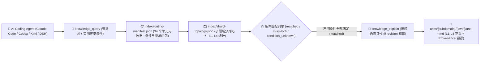

<p align="center">
  
</p>

<h1 align="center">MindIE Agent Knowledge — 图编译、自定义算子注册与运行时兼容知识库 (<code>knowledge-infer-ops-compat</code>)</h1>

<p align="center">
  <strong>面向昇腾 GE/TorchAir 图编译、自定义算子绑定与生态迁移的 L1–L4 分级工程知识库：覆盖 npugraph_ex/ACLGraph、torch.library/aclnn 注册、CANN/torch_npu ABI 兼容与 CUDA 迁移</strong>
</p>

<p align="center">
  <a href="https://github.com/mindie-agent/mindie-agent"></a>
  <a href="./publication-contract.json"></a>
  <a href="./publication-contract.json"></a>
  <a href="./index/routing-manifest.json"></a>
  <a href="./index/shard-topology.json"></a>
</p>

<p align="center">
  <strong>中文</strong> · <a href="./README.en.md">English</a> · <a href="#-一句话接入与检索">⚡ 一句话接入</a> · <a href="#️-领域全景与-l1l4-分级架构">🏗️ 分级架构</a> · <a href="#-子领域分布与代表性知识单元">📊 语料全景</a> · <a href="#-仓库结构与隐私质量门禁">🛡️ 结构与门禁</a>
</p>

---

## ⚡ 一句话接入与检索

你不需要手动克隆或配置索引。在 **Claude Code**、**OpenAI Codex CLI**、**Kimi Code** 或 **DeepSeek Harness (DSH)** 中，直接复制并发送下面这句话给你的 AI Agent：

```text
帮我安装一下这个 https://github.com/mindie-agent/mindie-agent
```

宿主插件就绪后会自动连接 [`mindie-knowledge`](https://github.com/mindie-agent/knowledge) 本地运行时，按需同步本仓库（`--domain infer-ops-compat`）并在本地构建毫秒级确定性检索索引。只读检索与全文读取**完全在本地执行，不消耗大模型 Token，也不要求开启社区共享**。

<details>
<summary>🤖 <b>AI Agent 自动安装与知识检索协议（点击展开 / Agent 读取本页时可直接解析执行）</b></summary>

> **给 AI Agent 的执行指南**：
>
> #### 1. 一键安装宿主插件
> 若当前宿主尚未安装 MindIE Agent，请先读取主仓库 [`https://github.com/mindie-agent/mindie-agent`](https://github.com/mindie-agent/mindie-agent) 的安装协议完成对应宿主插件注册。
>
> #### 2. 命令行同步与检查 `infer-ops-compat` 领域语料
> ```bash
> # 同步 infer-ops-compat 领域最新经校验的公开知识源（零模型调用）
> mindie-knowledge sync --domain infer-ops-compat
>
> # 查看本地知识索引状态与脱敏规则版本
> mindie-knowledge status --domain infer-ops-compat
> python3 -m mindie_knowledge.redact --profile
> ```
>
> #### 3. MCP 工具检索、精确全文读取与版本化反馈
> 在解决 `infer-ops-compat` 相关工程任务时，遵循 **先按实测条件检索 (`knowledge_query`) → 再按精确修订号读全文 (`knowledge_explain`) → 验证后可选反馈 (`knowledge_feedback`)** 的标准工作流：
>
> ```python
> # Step 1: 仅传入当前任务真实观测到的环境/版本条件（严禁猜测或抄写未观测条件）
> knowledge_query(
>     query="torch.compile npugraph_ex ACLGraph replay address refresh",
>     conditions={
>         "soc": "Ascend910B4"
>     },
> )
>
> # Step 2: 使用返回的精确修订引用 (@revision) 读取完整正文、前置条件与继承闭包
> knowledge_explain(
>     ref="mindie://infer-ops-compat/units/unit-npugraph-ex-aclgraph-replay-failure-and-address-refresh-sop@1",
> )
>
> # Step 3: 实机验证有效后，针对实际观测过的修订号记录本地有用性反馈（可选）
> knowledge_feedback(
>     ref="mindie://infer-ops-compat/units/unit-npugraph-ex-aclgraph-replay-failure-and-address-refresh-sop@1",
>     rating="up",
>     reason="Resolved TorchAir npugraph_ex ACLGraph replay failure caused by frozen workspace address.",
> )
> ```

</details>

---

## 🏗️ 领域全景与 L1–L4 分级架构

本仓库承载 MindIE Agent 的 **`infer-ops-compat` 领域分级知识源**（共 **34 个分级知识单元**：`L1: 3`、`L2: 21`、`L3: 9`、`L4: 1`）。聚焦 PyTorch / `torch_npu` 与昇腾 CANN 图编译器（GE / GERT / TorchAir `npugraph_ex` / ACLGraph）之间的桥接层：涵盖 FX 图捕获与 Pass 管线顺序公理、动态 shape 未知图切分与 IMAS/DevMM 静态内存复用、ACLGraph 冻结地址刷新与 D2H 同步护栏排障、AscendC `OpDef` / GE IR 原型与两阶段 `aclnn` ABI 注册、`torch.library` FakeTensor Meta 算子绑定、驱动/CANN/`torch_npu` 版本兼容栈以及 PyTorch CUDA 模型与算子向昇腾 NPU 的端到端迁移工作流。

### 1. `mindie-graded-unit/1` 四级知识单元体系（L1–L4）

本知识库拒绝碎片化的聊天摘要或脱离前提的“万能经验”，所有知识单元均按工程抽象粒度与可操作性划分为 **L1–L4 四个层级**（当前分布：**L1: 3 · L2: 21 · L3: 9 · L4: 1**）：

| 层级 | 标准类别 (`category`) | 工程定位 | 核心内容与准入要求 |
| :---: | --- | --- | --- |
| **L1** | `canonical-fact` (`axiom` / `measurement`) | **事实与约束标准** | 硬件微架构规格（UB/L1/HBM 对齐、双 Die 拓扑）、框架核心不变量、ABI 注册规则与四视图 Roofline 测量基线。常作为上层单元的继承前提（`parents`）。 |
| **L2** | `sop` | **标准排障与开发规程** | 确定性的分步诊断、算子开发、图编译护栏排查与精度比对标准作业程序（SOP），明确列出观测指标、判别分支与验证命令。 |
| **L3** | `workflow` | **多阶段工程工作流** | 端到端多阶段闭环工作流（如 0-day 模型适配、TTFT/TPOT 性能瓶颈收敛、分布式死锁根因定位、留一法消融实验）。 |
| **L4** | `optimization-pattern` (`mutator`) | **深度调优模式** | 经过实测验证的 Kernel / 计算图 / 通信并行代码变换模式（Mutator），附带严格的适用条件（`conditions`）、消融前后性能包络与源码溯源（`provenance`）。 |

### 2. 条件化路由与精确全文检索架构



> [!IMPORTANT]
> **严格条件匹配原则（No Silent Guesswork）**：查询时，`mindie-knowledge` 会将任务真实观测到的 `conditions` 与知识单元声明的适用前提逐项比对。只有所有声明条件均满足时才判定为 `matched`；缺失或未知的条件判定为 `condition_unknown` 并默认过滤，避免将特定硬件型号或特定源码提交下的结论误用于不兼容环境。

---

## 📊 子领域分布与代表性知识单元

[`index/routing-manifest.json`](./index/routing-manifest.json) 与 [`index/shard-topology.json`](./index/shard-topology.json) 是由全量 Markdown 单元派生的权威实时清单。当前仓库共包含 **34 个分级知识单元**（**L1: 3 · L2: 21 · L3: 9 · L4: 1**）：

### 1. 子领域（Subdomain）分布统计

| 子领域目录 | 单元数量 | 层级分布 (`L1–L4`) | 核心覆盖范围 |
| --- | :---: | :---: | --- |
| `graph` | **14** | `L1: 1, L2: 9, L3: 4` | TorchAir `npugraph_ex` 捕获与 Pass 管线公理、ACLGraph 重放失败与动态地址刷新、GE 动态 shape 切分、IMAS/DevMM 内存复用、AutoFuse Inductor LoopIR、SuperKernel 二进制融合、`MindIE-SD` Inductor 模式开发及 GERT Host Coredump GDB 排障 |
| `runtime` | **7** | `L1: 1, L2: 4, L3: 2` | 昇腾驱动 / CANN / `torch_npu` ABI 与 `SOC_VERSION` 兼容栈公理、多流 Cube-Vector 并发与 DBO 重叠、`npu_prefetch` 权重 L2 预取窗口、`torch.library` FakeTensor Meta 注册、`npugraph_ex` Reinplace 审计及编译/运行时分诊工作流 |
| `deployment` | **6** | `L2: 5, L3: 1` | 昇腾容器三种挂载模式与驱动/固件安装顺序、CANN `Toolkit -> Kernels -> NNAL` 安装校验、MindIE Service 配置/TLS/显存预算契约、`vllm-ascend` 构建入口、WheelNext/310P Triton 兼容栈及 Volcano Kthena / MindIE Motor PD 云原生部署工作流 |
| `registration` | **4** | `L1: 1, L2: 2, L4: 1` | AscendC `OpDef` Host 注册、GE IR 原型映射与两阶段 `aclnn` ABI 契约公理、`InferShape`/`TilingData` 结构体对齐 SOP、PyTorch C++ 扩展 `EXEC_NPU_CMD` 绑定及直调 Kernel + Meta 注册 L4 Mutator |
| `migration` | **3** | `L2: 1, L3: 2` | 面向 CUDA 的 PyTorch 推理模型与算子向 `torch_npu` 及 `vllm-ascend` 迁移工作流、GPU-to-Ascend 迁移审计与 `npu-smi` vNPU 健康分诊 SOP，以及 ATC ONNX-to-OM 动态输入探测与精度核验工作流 |

### 2. 代表性分级知识单元（Representative Units）

| 知识单元 ID（点击查看原文） | 子领域 | 层级 / 类别 | 工程主题与摘要 | 固定修订引用 (`ref`) |
| --- | :---: | :---: | --- | --- |
| [`unit-npugraph-ex-capture-lowering-and-pass-pipeline-axioms`](./graph/npugraph-ex/architecture-and-passes/unit-npugraph-ex-capture-lowering-and-pass-pipeline-axioms.md) | `graph` | **L1** / `axiom` | TorchAir npugraph_ex Capture, FX Lowering, and Pass Pipeline Ordering Axioms | `mindie://infer-ops-compat/units/unit-npugraph-ex-capture-lowering-and-pass-pipeline-axioms@1` |
| [`unit-ascend-cann-driver-and-torch-npu-abi-compatibility-axioms`](./runtime/cann-torch-npu/unit-ascend-cann-driver-and-torch-npu-abi-compatibility-axioms.md) | `runtime` | **L1** / `axiom` | Ascend driver, CANN, torch_npu ABI and SOC_VERSION form one compatibility stack | `mindie://infer-ops-compat/units/unit-ascend-cann-driver-and-torch-npu-abi-compatibility-axioms@1` |
| [`unit-ascendc-opdef-geir-proto-and-aclnn-two-stage-abi-axioms`](./registration/custom-ops/aclnn-and-geir/unit-ascendc-opdef-geir-proto-and-aclnn-two-stage-abi-axioms.md) | `registration` | **L1** / `axiom` | AscendC OpDef Host Registration, GE IR Prototype Mapping, and Two-Stage aclnn ABI Contract Axioms | `mindie://infer-ops-compat/units/unit-ascendc-opdef-geir-proto-and-aclnn-two-stage-abi-axioms@1` |
| [`unit-npugraph-ex-aclgraph-replay-failure-and-address-refresh-sop`](./graph/npugraph-ex/runtime-and-accuracy-dfx/unit-npugraph-ex-aclgraph-replay-failure-and-address-refresh-sop.md) | `graph` | **L2** / `sop` | TorchAir npugraph_ex ACLGraph Replay Failure, Dynamic Workspace, and Frozen Address Refresh SOP | `mindie://infer-ops-compat/units/unit-npugraph-ex-aclgraph-replay-failure-and-address-refresh-sop@1` |
| [`unit-torch-npu-custom-op-registration-and-faketensor-meta-sop`](./runtime/torch-npu/unit-torch-npu-custom-op-registration-and-faketensor-meta-sop.md) | `runtime` | **L2** / `sop` | Bind AscendC and aclnn custom ops into torch.library with a device-free FakeTensor Meta kernel | `mindie://infer-ops-compat/units/unit-torch-npu-custom-op-registration-and-faketensor-meta-sop@1` |
| [`unit-ascendc-infershape-tilingdata-and-workspace-registration-sop`](./registration/custom-ops/aclnn-and-geir/unit-ascendc-infershape-tilingdata-and-workspace-registration-sop.md) | `registration` | **L2** / `sop` | AscendC InferShape, InferDataType, TilingData Struct Alignment, and Workspace Registration SOP | `mindie://infer-ops-compat/units/unit-ascendc-infershape-tilingdata-and-workspace-registration-sop@1` |
| [`unit-mindie-service-config-security-and-npu-memory-budget-sop`](./deployment/mindie-service/unit-mindie-service-config-security-and-npu-memory-budget-sop.md) | `deployment` | **L2** / `sop` | MindIE Service config, TLS permissions and NPU memory budget are one startup contract | `mindie://infer-ops-compat/units/unit-mindie-service-config-security-and-npu-memory-budget-sop@1` |
| [`unit-torch-npugraph-ex-five-step-triage-and-compile-runtime-diagnosis-workflow`](./runtime/torch-npu/unit-torch-npugraph-ex-five-step-triage-and-compile-runtime-diagnosis-workflow.md) | `runtime` | **L3** / `workflow` | Five-step progressive backend triage and compile-vs-runtime root-cause diagnosis workflow for torch.compile npugraph_ex | `mindie://infer-ops-compat/units/unit-torch-npugraph-ex-five-step-triage-and-compile-runtime-diagnosis-workflow@1` |
| [`unit-ge-pattern-fusion-pass-and-buffer-fusion-triage-workflow`](./graph/ge-compiler/fusion-passes-and-compile/unit-ge-pattern-fusion-pass-and-buffer-fusion-triage-workflow.md) | `graph` | **L3** / `workflow` | Ascend GE Graph PatternFusionBasePass, UB Buffer Fusion, and Pass Miscompilation Triage Workflow | `mindie://infer-ops-compat/units/unit-ge-pattern-fusion-pass-and-buffer-fusion-triage-workflow@1` |
| [`unit-ge-compiler-and-gert-host-coredump-gdb-triage-workflow`](./graph/ge-compiler/memory-and-coredump/unit-ge-compiler-and-gert-host-coredump-gdb-triage-workflow.md) | `graph` | **L3** / `workflow` | Ascend GE Compiler and GERT Runtime Host Coredump GDB Stack and Symbol Disassembly Triage Workflow | `mindie://infer-ops-compat/units/unit-ge-compiler-and-gert-host-coredump-gdb-triage-workflow@1` |
| [`unit-pytorch-cuda-to-torch-npu-serving-migration-workflow`](./migration/cuda-to-npu/unit-pytorch-cuda-to-torch-npu-serving-migration-workflow.md) | `migration` | **L3** / `workflow` | Migrate CUDA-oriented PyTorch inference models and kernels to torch_npu and vllm-ascend | `mindie://infer-ops-compat/units/unit-pytorch-cuda-to-torch-npu-serving-migration-workflow@1` |
| [`unit-torch-npu-custom-op-ascendc-direct-kernel-and-aclnn-mutator`](./registration/custom-ops/torch-cpp-extensions/unit-torch-npu-custom-op-ascendc-direct-kernel-and-aclnn-mutator.md) | `registration` | **L4** / `mutator` | PyTorch NPU Custom Op AscendC Direct Kernel Launch, aclnn Two-Stage Wrapper, and Meta Registration Mutator | `mindie://infer-ops-compat/units/unit-torch-npu-custom-op-ascendc-direct-kernel-and-aclnn-mutator@1` |
| [`unit-mindie-sd-inductor-pattern-dev-and-two-stage-framework-integration-sop`](./graph/mindie-sd-and-omni/compile-and-integration/unit-mindie-sd-inductor-pattern-dev-and-two-stage-framework-integration-sop.md) | `graph` | **L2** / `sop` | MindIE-SD torch_npu._inductor PatternMatcherPass development and two-stage (API-first, then compile) framework integration SOP | `mindie://infer-ops-compat/units/unit-mindie-sd-inductor-pattern-dev-and-two-stage-framework-integration-sop@1` |

---

## 🛡️ 仓库结构与隐私质量门禁

### 1. 仓库目录结构

```text
knowledge-infer-ops-compat/
├── publication-contract.json           # 发布契约 (mindie-publication-contract/2) 与固定 Validator 修订号
├── AGENTS.md                           # 维护者与 AI Agent 仓库操作边界规范
├── README.md                           # 中文主文档
├── README.en.md                        # 英文主文档 (English Documentation)
├── LICENSE                             # 双许可声明 (CC BY 4.0 语料与文档 + MIT 维护脚本)
├── index/
│   ├── routing-manifest.json           # [派生索引] 全量单元 ID、路径、层级、条件、继承闭包与 Token 估算
│   └── shard-topology.json             # [派生索引] 子领域分片计数与层级拓扑
├── <subdomain>/.../unit-*.md           # [核心语料] L1–L4 分级知识单元 Markdown 正文与 YAML Frontmatter
└── docs/
    └── evidence/                       # 源码审计收据、实验消融数据与溯源证据
```

### 2. 双层隐私脱敏与确定性 CI 发布门禁（`.github/workflows/check.yml`）

本仓库作为公开工程知识源，在本地构建与 GitHub Actions CI（`check.yml`）中强制执行**零信任数据校验与双层隐私脱敏门禁**：

1. **不可变契约与纯数据校验（`publication_check.validate`）**：
   - CI 从可信基准读取 [`publication-contract.json`](./publication-contract.json)，安装精确固定提交的 `mindie-knowledge` 校验器；
   - 所有候选文件仅作为 Git 数据对象（`git cat-file --batch`）流式读取，**绝不在 CI 中执行任何候选代码**；
   - 严格校验每个 `unit-*.md` 的 Schema（`mindie-graded-unit/1`）、路径与稳定 ID 一致性、修订号与 SHA-256 内容摘要、父子继承有向无环图（DAG），以及 `index/routing-manifest.json` 和 `index/shard-topology.json` 与实际单元的 100% 一致性。
2. **双层闭锁式隐私扫描（Gitleaks + `mindie_knowledge.redact` `r3`）**：
   - 全仓所有文本文件、知识单元 Frontmatter/正文、公开反馈及 PR 标题/描述均经过确定性隐私扫描；
   - **严禁包含**任何本地宿主绝对路径（如个人主目录、挂载卷路径）、私有内网 IPv4/IPv6 地址段、SSH 登录凭据、API 密钥或内部机器名，一旦命中立即阻断合入。

---

## 🔗 关联仓库与生态导航

- **主仓库与一键安装入口**：[`mindie-agent/mindie-agent`](https://github.com/mindie-agent/mindie-agent)
- **知识检索与隐私脱敏运行时**：[`mindie-agent/knowledge`](https://github.com/mindie-agent/knowledge)（Python 包 `mindie-knowledge`）
- **七大公开领域知识库矩阵**：
  - [`knowledge-vllm-ascend`](https://github.com/mindie-agent/knowledge-vllm-ascend) — `vLLM-Ascend` 与 `vLLM-Omni` 适配、图编译、MoE、PD 分离与多阶段全模态流水线（91 Units）
  - [`knowledge-operators`](https://github.com/mindie-agent/knowledge-operators) — AscendC / BiShengIR / Triton / TileLang / MindIE-SD 算子开发与优化（105 Units）
  - [`knowledge-infer-core`](https://github.com/mindie-agent/knowledge-infer-core) — 核心推理引擎调度、KV Cache、`MindIE-SD` 扩散加速与服务化架构（109 Units）
  - [`knowledge-infer-distributed`](https://github.com/mindie-agent/knowledge-infer-distributed) — HCCL 集合通信、RoCE/HCCS 拓扑、Ulysses/Ring/CFG 混合并行与 SHMEM（39 Units）
  - [`knowledge-infer-observability`](https://github.com/mindie-agent/knowledge-infer-observability) — CANN 故障诊断、`msprof` 性能剖析与 A/B/A 性能/精度门禁（39 Units）
  - [`knowledge-infer-ops-compat`](https://github.com/mindie-agent/knowledge-infer-ops-compat) — GE/TorchAir/Inductor 图编译、自定义算子注册与两阶段框架集成（34 Units）
  - [`knowledge-agent-engineering`](https://github.com/mindie-agent/knowledge-agent-engineering) — 智能体编排、S0–S6 自动调优工作流、脱敏审计与基准评测（33 Units）

---

## 📄 开源许可（License）

本仓库遵循 [`LICENSE`](./LICENSE) 双许可声明（与 `mindie-publication-contract/2` 仓库结构对齐）：

- **知识语料、派生索引、公开反馈与文档证据**（`<domain_path>/unit-*.md`、`index/`、`feedback/`、`README.md`、`README.en.md`、`AGENTS.md`、`docs/`）采用 **[Creative Commons Attribution 4.0 International (CC BY 4.0)](./LICENSE)** 许可协议。
- **仓库维护脚本与工作流配置**（`scripts/`、`.github/workflows/`、`publication-contract.json`）采用 **[MIT License](./LICENSE)** 许可协议。
